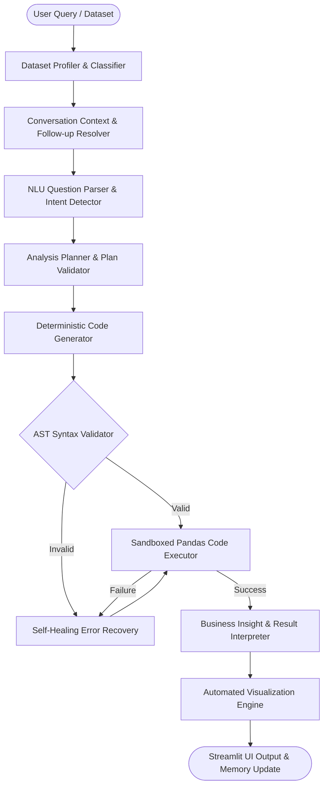

# 📊 Intelligent Business Data Analysis Agent

An autonomous, multi-agent AI framework for tabular business data analysis. The agent translates natural language business questions into structured analysis plans, generates and validates executable Python code, runs sandboxed computations, and outputs natural language business insights and dynamic visualizations.

[](https://www.python.org/)
[](https://streamlit.io/)
[](https://pandas.pydata.org/)
[](outputs/TEST_CASES_CATALOG.md)
[](LICENSE)

---

## 🌟 Key Capabilities

- **🔍 Automated Dataset Profiling & Understanding:** Instant schema analysis, automated column classification (numerical, categorical, datetime), missing value audit, and duplicate detection for CSV and Excel files.
- **💬 Natural Language Query Processing (NLU):** Recognizes analytical intent (aggregations, grouped breakdowns, statistical distributions, temporal trends, correlation matrices, and conditional filters).
- **🧠 Multi-Turn Context & Conversation Memory:** Retains session context to resolve conversational follow-up queries (e.g., asking *"What about Quantity?"* immediately after *"What is the total Sales?"*).
- **⚙️ Deterministic Code Generation & AST Validation:** Translates structured analytical plans into pure Pandas code and validates syntax via Abstract Syntax Trees (AST) before execution.
- **🛡️ Self-Healing Error Recovery:** Handles runtime exceptions (missing columns, missing results) with automatic error recovery and column suggestion diagnostics.
- **📈 Automatic Visualizations:** Automatically renders appropriate charts (comparison bar charts, trend lines, distributions, scatter correlations) using Matplotlib.
- **🖥️ Interactive Web Dashboard:** Built with Streamlit for seamless file uploading, interactive query execution, and conversation history tracking.

---

## 🏗️ System Architecture & Workflow



---

## 📁 Repository Structure

```text
├── app/
│   ├── main.py                     # Streamlit web application & UI orchestrator
│   ├── config.py                   # App styling, layout, and metadata
│   ├── agents/
│   │   ├── agent.py                # Core AnalysisAgent orchestrator
│   │   ├── agent_state.py          # Execution state & error tracking
│   │   ├── planner.py              # Translates NLU intent into analysis plans
│   │   ├── plan_validator.py       # Analytical feasibility validator
│   │   ├── code_generator.py       # Converts plan to executable Pandas code
│   │   ├── code_validator.py       # AST syntax safety validator
│   │   ├── code_pipeline.py        # End-to-end code generation pipeline
│   │   └── interpreter.py          # Generates human business insights
│   ├── analysis/
│   │   └── executor.py             # Sandboxed Python execution engine
│   ├── data/
│   │   ├── loader.py               # CSV and Excel dataset loader
│   │   ├── understanding.py        # Dataset understanding pipeline
│   │   ├── profiler.py             # Dimensions, nulls, duplicates
│   │   ├── numerical.py            # Summary statistics for numeric fields
│   │   ├── categorical.py          # Cardinality and category distributions
│   │   ├── quality.py              # Data health and completeness report
│   │   └── classifier.py           # Column type classification
│   ├── memory/
│   │   ├── conversation_memory.py  # Session memory store
│   │   ├── conversation_context.py # Context coordinator
│   │   ├── context_resolver.py     # Reconstructs elliptical follow-ups
│   │   └── followup_detector.py    # Pattern detector for follow-up questions
│   ├── nlu/
│   │   ├── question_parser.py      # Entry point for question parsing
│   │   ├── intent_detector.py      # Analytical intent classifier
│   │   ├── entity_extractor.py     # Target metric, grouping & filter extractor
│   │   └── nlu_validator.py        # NLU output schema validator
│   └── visualization/
│       └── visualizer.py           # Matplotlib / Altair chart generator
├── data/                           # Verified sample datasets
│   ├── test_sales.csv              # Categorical and numerical business data
│   ├── trend_sales.csv             # Time-series sales data
│   ├── ecommerce_customer_churn.csv # E-commerce customer churn, spend & satisfaction records
│   └── financial_quarterly_performance.csv # Multi-department quarterly financial performance
├── docs/
│   └── EXECUTION_GUIDE.md          # Comprehensive step-by-step execution guide
├── outputs/                        # Test logs, execution outputs & generated charts
│   ├── TEST_CASES_CATALOG.md       # Detailed catalog of all 51 unit tests
│   ├── sample_analysis_outputs.md  # Real execution logs across sample queries
│   ├── sample_analysis_outputs.json# Machine-readable execution logs
│   ├── unit_test_results.txt       # Unit test runner terminal output
│   └── visualizations/             # Generated charts (bar, line, distribution)
├── tests/                          # Automated unit test suite (45 tests)
├── test_code_generator.py          # Standalone code generation tests
├── test_code_pipeline.py           # Standalone pipeline tests
├── test_code_validator.py          # Standalone syntax validation tests
└── requirements.txt                # Python package dependencies
```

---

## 🚀 Quickstart Guide

### 1. Clone & Setup Environment
```powershell
# Clone the repository
git clone https://github.com/vidyavanreddy/Intelligent-Business-Data-Analysis-Agent.git
cd Intelligent-Business-Data-Analysis-Agent

# Create virtual environment with Python 3.10+ (recommended)
py -3.10 -m venv .venv
.\.venv\Scripts\Activate.ps1    # On Windows
# source .venv/bin/activate     # On Linux / macOS
```

### 2. Install Dependencies
```powershell
pip install -r requirements.txt
```

### 3. Launch the Application
```powershell
streamlit run app/main.py
```
Open **`http://localhost:8501`** in your browser.

---

## 🧪 Testing & Verification

The project includes 51 unit tests covering NLU, planning, code generation, execution recovery, and multi-turn context resolution:

```powershell
# Run the complete test suite
python -m unittest discover -s tests
```

- **Test Suite Results:** 51 tests, 0 failures, 100% pass rate.
- View the complete test catalog in [outputs/TEST_CASES_CATALOG.md](outputs/TEST_CASES_CATALOG.md).
- View verified end-to-end execution logs and generated plots in [outputs/sample_analysis_outputs.md](outputs/sample_analysis_outputs.md).

---

## 📖 Documentation

- 📘 **[Execution Guide](docs/EXECUTION_GUIDE.md):** Detailed guide on environment configuration, deployment, UI features, and troubleshooting.
- 📋 **[Test Cases Catalog](outputs/TEST_CASES_CATALOG.md):** Breakdown of all 51 test cases categorized by component.
- 📊 **[Sample Outputs & Plots](outputs/sample_analysis_outputs.md):** Real execution runs across 4 datasets, generated code, business insights, and visualization figures.

---

## 📄 License

This project is licensed under the MIT License.
