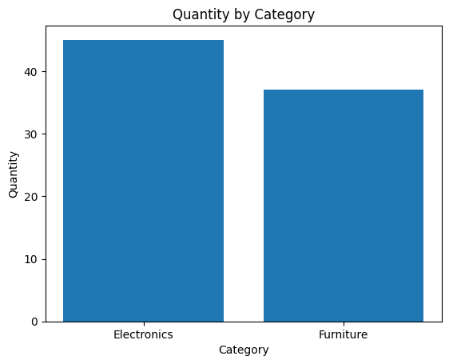
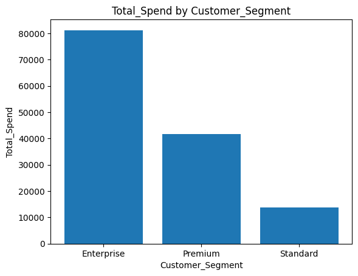
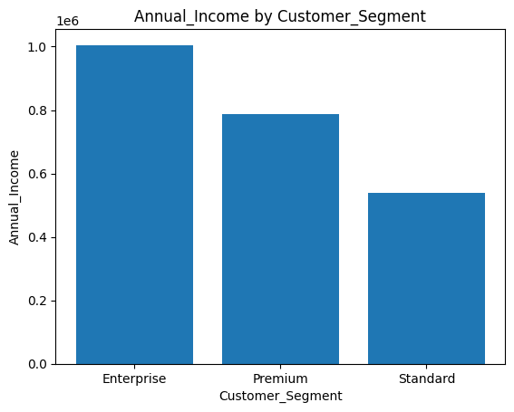
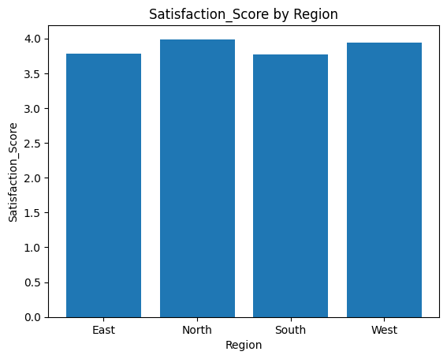
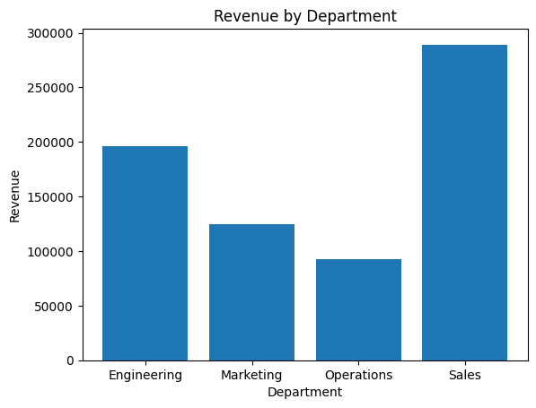
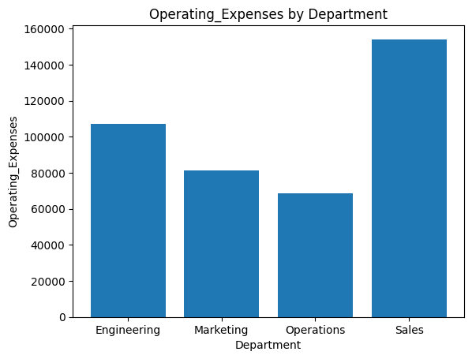
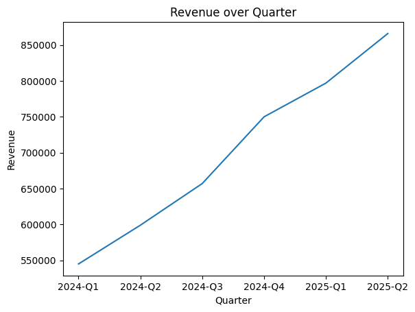

# Sample Analysis Execution Outputs

This document contains verified end-to-end execution logs and generated artifacts produced by the **Intelligent Business Data Analysis Agent** across 4 distinct business datasets.

## 1. Verified Datasets Overview

### `data/test_sales.csv`
- **Rows:** 5
- **Columns:** 4
- **Column Names:** `Product, Category, Sales, Quantity`
- **Missing Values:** `{'Product': 0, 'Category': 0, 'Sales': 0, 'Quantity': 0}`
- **Classifications:** `{'Product': 'categorical', 'Category': 'categorical', 'Sales': 'numerical', 'Quantity': 'numerical'}`

### `data/trend_sales.csv`
- **Rows:** 5
- **Columns:** 3
- **Column Names:** `Date, Sales, Quantity`
- **Missing Values:** `{'Date': 0, 'Sales': 0, 'Quantity': 0}`
- **Classifications:** `{'Date': 'categorical', 'Sales': 'numerical', 'Quantity': 'numerical'}`

### `data/ecommerce_customer_churn.csv`
- **Rows:** 30
- **Columns:** 9
- **Column Names:** `CustomerID, Customer_Segment, Age, Region, Annual_Income, Total_Spend, Orders_Count, Satisfaction_Score, Churn_Status`
- **Missing Values:** `{'CustomerID': 0, 'Customer_Segment': 0, 'Age': 0, 'Region': 0, 'Annual_Income': 0, 'Total_Spend': 0, 'Orders_Count': 0, 'Satisfaction_Score': 0, 'Churn_Status': 0}`
- **Classifications:** `{'CustomerID': 'categorical', 'Customer_Segment': 'categorical', 'Age': 'numerical', 'Region': 'categorical', 'Annual_Income': 'numerical', 'Total_Spend': 'numerical', 'Orders_Count': 'numerical', 'Satisfaction_Score': 'numerical', 'Churn_Status': 'categorical'}`

### `data/financial_quarterly_performance.csv`
- **Rows:** 24
- **Columns:** 7
- **Column Names:** `Quarter, Department, Revenue, Operating_Expenses, Net_Profit, Headcount, Growth_Rate_Pct`
- **Missing Values:** `{'Quarter': 0, 'Department': 0, 'Revenue': 0, 'Operating_Expenses': 0, 'Net_Profit': 0, 'Headcount': 0, 'Growth_Rate_Pct': 0}`
- **Classifications:** `{'Quarter': 'categorical', 'Department': 'categorical', 'Revenue': 'numerical', 'Operating_Expenses': 'numerical', 'Net_Profit': 'numerical', 'Headcount': 'numerical', 'Growth_Rate_Pct': 'numerical'}`

## 2. Multi-Dataset Execution & Memory Verification Log

### Query 1: "What is the total Sales by Category?" (`data/test_sales.csv`)

- **Generated Python Code:**
```python
result = df.groupby("Category")["Sales"].sum()
```
- **Execution Status:** `Success`
- **Raw Result:**
```
Category
Electronics    100000
Furniture       25000
```
- **Agent Interpretation:** Electronics has the highest Sales with 100,000.00.
- **Business Insight:** Electronics has the highest Sales with 100,000.00.
Electronics is the strongest-performing Category based on Sales, while Furniture has the lowest value.
- **Generated Chart:** `outputs/visualizations/sales_by_category.png`


---

### Query 2: "What about Quantity?" (`data/test_sales.csv`)

> 💡 **Context Follow-up Resolved:** `"What is the total Quantity by Category?"`

- **Generated Python Code:**
```python
result = df.groupby("Category")["Quantity"].sum()
```
- **Execution Status:** `Success`
- **Raw Result:**
```
Category
Electronics    45
Furniture      37
```
- **Agent Interpretation:** Electronics has the highest Quantity with 45.00.
- **Business Insight:** Electronics has the highest Quantity with 45.00.
Electronics is the strongest-performing Category based on Quantity, while Furniture has the lowest value.
- **Generated Chart:** `outputs/visualizations/quantity_by_category_followup.png`



---

### Query 3: "Show the distribution of Quantity" (`data/test_sales.csv`)

- **Generated Python Code:**
```python
result = df["Quantity"].describe()
```
- **Execution Status:** `Success`
- **Raw Result:**
```
count     5.000000
mean     16.400000
std       6.107373
min      10.000000
25%      12.000000
50%      15.000000
75%      20.000000
max      25.000000
```
- **Agent Interpretation:** The Quantity distribution contains 5 records, with an average of 16.40. Values range from 10.00 to 25.00.
- **Business Insight:** The Quantity distribution contains 5 records, with an average of 16.40. Values range from 10.00 to 25.00.
Business insight: The Quantity distribution contains 5 records, with an average of 16.40. Values range from 10.00 to 25.00.
- **Generated Chart:** `outputs/visualizations/quantity_distribution.png`


---

### Query 4: "What is the relationship between Sales and Quantity?" (`data/test_sales.csv`)

- **Generated Python Code:**
```python
result = df[["Sales", "Quantity"]].corr()
```
- **Execution Status:** `Success`
- **Raw Result:**
```
             Sales  Quantity
Sales     1.000000 -0.569558
Quantity -0.569558  1.000000
```
- **Agent Interpretation:** Sales and Quantity have a moderate negative relationship with a correlation of -0.57.
- **Business Insight:** Sales and Quantity have a moderate negative relationship with a correlation of -0.57.
Sales and Quantity show a moderate negative relationship in the analyzed data.
- **Generated Chart:** `outputs/visualizations/sales_quantity_correlation.png`


---

### Query 5: "Sales trend over Date" (`data/trend_sales.csv`)

- **Generated Python Code:**
```python
result = df.groupby("Date")["Sales"].sum()
```
- **Execution Status:** `Success`
- **Raw Result:**
```
Date
2026-01-01    10000
2026-02-01    15000
2026-03-01    20000
2026-04-01    25000
2026-05-01    30000
```
- **Agent Interpretation:** Sales shows an increasing trend, rising from 10,000.00 to 30,000.00.
- **Business Insight:** Sales shows an increasing trend, rising from 10,000.00 to 30,000.00.
Sales is showing consistent growth across the analyzed period.
- **Generated Chart:** `outputs/visualizations/sales_trend_over_date.png`


---

### Query 6: "What is the total Total_Spend by Customer_Segment?" (`data/ecommerce_customer_churn.csv`)

- **Generated Python Code:**
```python
result = df.groupby("Customer_Segment")["Total_Spend"].sum()
```
- **Execution Status:** `Success`
- **Raw Result:**
```
Customer_Segment
Enterprise    81200
Premium       41600
Standard      13850
```
- **Agent Interpretation:** Enterprise has the highest Total_Spend with 81,200.00.
- **Business Insight:** Enterprise has the highest Total_Spend with 81,200.00.
Enterprise is the strongest-performing Customer_Segment based on Total_Spend, while Standard has the lowest value.
- **Generated Chart:** `outputs/visualizations/churn_spend_by_segment.png`



---

### Query 7: "What about Annual_Income?" (`data/ecommerce_customer_churn.csv`)

> 💡 **Context Follow-up Resolved:** `"What is the total Annual_Income by Customer_Segment?"`

- **Generated Python Code:**
```python
result = df.groupby("Customer_Segment")["Annual_Income"].sum()
```
- **Execution Status:** `Success`
- **Raw Result:**
```
Customer_Segment
Enterprise    1005000
Premium        787000
Standard       538000
```
- **Agent Interpretation:** Enterprise has the highest Annual_Income with 1,005,000.00.
- **Business Insight:** Enterprise has the highest Annual_Income with 1,005,000.00.
Enterprise is the strongest-performing Customer_Segment based on Annual_Income, while Standard has the lowest value.
- **Generated Chart:** `outputs/visualizations/churn_income_followup.png`



---

### Query 8: "What is the average Satisfaction_Score by Region?" (`data/ecommerce_customer_churn.csv`)

- **Generated Python Code:**
```python
result = df.groupby("Region")["Satisfaction_Score"].mean()
```
- **Execution Status:** `Success`
- **Raw Result:**
```
Region
East     3.785714
North    3.988889
South    3.771429
West     3.942857
```
- **Agent Interpretation:** North has the highest average Satisfaction_Score with 3.99.
- **Business Insight:** North has the highest average Satisfaction_Score with 3.99.
North is the strongest-performing Region based on Satisfaction_Score, while South has the lowest value.
- **Generated Chart:** `outputs/visualizations/churn_satisfaction_by_region.png`



---

### Query 9: "What is the average Revenue by Department?" (`data/financial_quarterly_performance.csv`)

- **Generated Python Code:**
```python
result = df.groupby("Department")["Revenue"].mean()
```
- **Execution Status:** `Success`
- **Raw Result:**
```
Department
Engineering    195833.333333
Marketing      125000.000000
Operations      92333.333333
Sales          289166.666667
```
- **Agent Interpretation:** Sales has the highest average Revenue with 289,166.67.
- **Business Insight:** Sales has the highest average Revenue with 289,166.67.
Sales is the strongest-performing Department based on Revenue, while Operations has the lowest value.
- **Generated Chart:** `outputs/visualizations/financial_revenue_by_department.png`



---

### Query 10: "What about Operating_Expenses?" (`data/financial_quarterly_performance.csv`)

> 💡 **Context Follow-up Resolved:** `"What is the average Operating_Expenses by Department?"`

- **Generated Python Code:**
```python
result = df.groupby("Department")["Operating_Expenses"].mean()
```
- **Execution Status:** `Success`
- **Raw Result:**
```
Department
Engineering    107000.000000
Marketing       81333.333333
Operations      68500.000000
Sales          154166.666667
```
- **Agent Interpretation:** Sales has the highest average Operating_Expenses with 154,166.67.
- **Business Insight:** Sales has the highest average Operating_Expenses with 154,166.67.
Sales is the strongest-performing Department based on Operating_Expenses, while Operations has the lowest value.
- **Generated Chart:** `outputs/visualizations/financial_expenses_followup.png`



---

### Query 11: "Revenue trend over Quarter" (`data/financial_quarterly_performance.csv`)

- **Generated Python Code:**
```python
result = df.groupby("Quarter")["Revenue"].sum()
```
- **Execution Status:** `Success`
- **Raw Result:**
```
Quarter
2024-Q1    545000
2024-Q2    599000
2024-Q3    657000
2024-Q4    750000
2025-Q1    797000
2025-Q2    866000
```
- **Agent Interpretation:** Revenue shows an increasing trend, rising from 545,000.00 to 866,000.00.
- **Business Insight:** Revenue shows an increasing trend, rising from 545,000.00 to 866,000.00.
Revenue is showing consistent growth across the analyzed period.
- **Generated Chart:** `outputs/visualizations/financial_revenue_trend.png`



---

