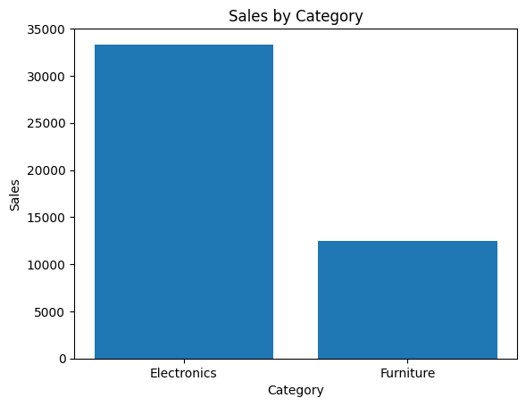
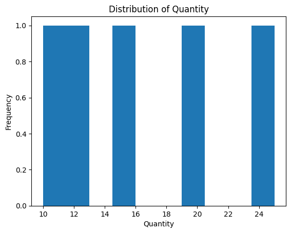
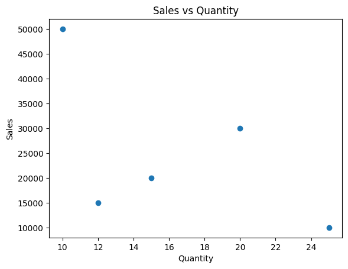
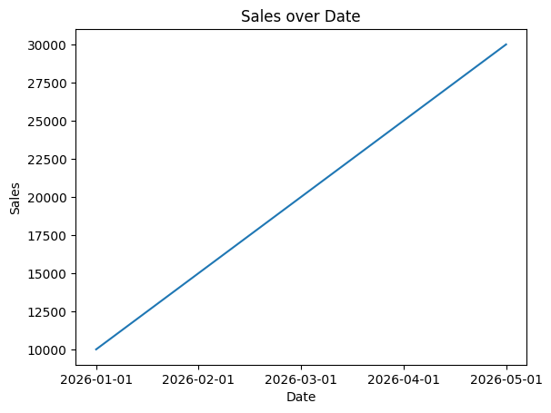

# Sample Analysis Execution Outputs

This document contains verified end-to-end execution logs and generated artifacts produced by the **Intelligent Business Data Analysis Agent**.

## 1. Dataset Profiles & Automated Understanding

### A. `data/test_sales.csv`
- **Rows:** 5
- **Columns:** 4
- **Column Names:** `Product, Category, Sales, Quantity`
- **Missing Values:** `{'Product': 0, 'Category': 0, 'Sales': 0, 'Quantity': 0}`
- **Duplicate Rows:** `0`
- **Classifications:** `{'Product': 'categorical', 'Category': 'categorical', 'Sales': 'numerical', 'Quantity': 'numerical'}`

### B. `data/trend_sales.csv`
- **Rows:** 5
- **Columns:** 3
- **Column Names:** `Date, Sales, Quantity`
- **Missing Values:** `{'Date': 0, 'Sales': 0, 'Quantity': 0}`
- **Classifications:** `{'Date': 'categorical', 'Sales': 'numerical', 'Quantity': 'numerical'}`

## 2. Real Query Execution Log

### Query 1: "What is the total Sales?"

- **Generated Python Code:**
```python
result = df["Sales"].sum()
```
- **Execution Status:** `Success`
- **Raw Result:**
```
125000
```
- **Agent Interpretation:** Analysis result: 125000
- **Business Insight:** Analysis result: 125000
The analysis shows the total Sales for the available data.
- **Generated Chart:** `None (Scalar/Tabular result)`

---

### Query 2: "What about Quantity?"

> 💡 **Context Follow-up Resolved:** `"What is the total Quantity?"`

- **Generated Python Code:**
```python
result = df["Quantity"].sum()
```
- **Execution Status:** `Success`
- **Raw Result:**
```
82
```
- **Agent Interpretation:** Analysis result: 82
- **Business Insight:** Analysis result: 82
The analysis shows the total Quantity for the available data.
- **Generated Chart:** `None (Scalar/Tabular result)`

---

### Query 3: "What is the average Sales by Category?"

- **Generated Python Code:**
```python
result = df.groupby("Category")["Sales"].mean()
```
- **Execution Status:** `Success`
- **Raw Result:**
```
Category
Electronics    33333.333333
Furniture      12500.000000
```
- **Agent Interpretation:** Analysis result: Category
Electronics    33333.333333
Furniture      12500.000000
Name: Sales, dtype: float64
- **Business Insight:** Analysis result: Category
Electronics    33333.333333
Furniture      12500.000000
Name: Sales, dtype: float64
The analysis shows the average Sales across the available records.
- **Generated Chart:** `outputs/visualizations/sales_by_category.png`



---

### Query 4: "Show the distribution of Quantity"

- **Generated Python Code:**
```python
result = df["Quantity"].describe()
```
- **Execution Status:** `Success`
- **Raw Result:**
```
count     5.000000
mean     16.400000
std       6.107373
min      10.000000
25%      12.000000
50%      15.000000
75%      20.000000
max      25.000000
```
- **Agent Interpretation:** Analysis result: count     5.000000
mean     16.400000
std       6.107373
min      10.000000
25%      12.000000
50%      15.000000
75%      20.000000
max      25.000000
Name: Quantity, dtype: float64
- **Business Insight:** Analysis result: count     5.000000
mean     16.400000
std       6.107373
min      10.000000
25%      12.000000
50%      15.000000
75%      20.000000
max      25.000000
Name: Quantity, dtype: float64
Business insight: Analysis result: count     5.000000
mean     16.400000
std       6.107373
min      10.000000
25%      12.000000
50%      15.000000
75%      20.000000
max      25.000000
Name: Quantity, dtype: float64
- **Generated Chart:** `outputs/visualizations/quantity_distribution.png`



---

### Query 5: "What is the relationship between Sales and Quantity?"

- **Generated Python Code:**
```python
result = df[["Sales", "Quantity"]].corr()
```
- **Execution Status:** `Success`
- **Raw Result:**
```
             Sales  Quantity
Sales     1.000000 -0.569558
Quantity -0.569558  1.000000
```
- **Agent Interpretation:** Analysis result:              Sales  Quantity
Sales     1.000000 -0.569558
Quantity -0.569558  1.000000
- **Business Insight:** Analysis result:              Sales  Quantity
Sales     1.000000 -0.569558
Quantity -0.569558  1.000000
The analysis examines the relationship between Sales and Quantity.
- **Generated Chart:** `outputs/visualizations/sales_quantity_correlation.png`



---

### Query 6: "Sales trend over Date"

- **Generated Python Code:**
```python
result = df.groupby("Date")["Sales"].sum()
```
- **Execution Status:** `Success`
- **Raw Result:**
```
Date
2026-01-01    10000
2026-02-01    15000
2026-03-01    20000
2026-04-01    25000
2026-05-01    30000
```
- **Agent Interpretation:** Analysis result: Date
2026-01-01    10000
2026-02-01    15000
2026-03-01    20000
2026-04-01    25000
2026-05-01    30000
Name: Sales, dtype: int64
- **Business Insight:** Analysis result: Date
2026-01-01    10000
2026-02-01    15000
2026-03-01    20000
2026-04-01    25000
2026-05-01    30000
Name: Sales, dtype: int64
Business insight: Analysis result: Date
2026-01-01    10000
2026-02-01    15000
2026-03-01    20000
2026-04-01    25000
2026-05-01    30000
Name: Sales, dtype: int64
- **Generated Chart:** `outputs/visualizations/sales_trend_over_date.png`



---

